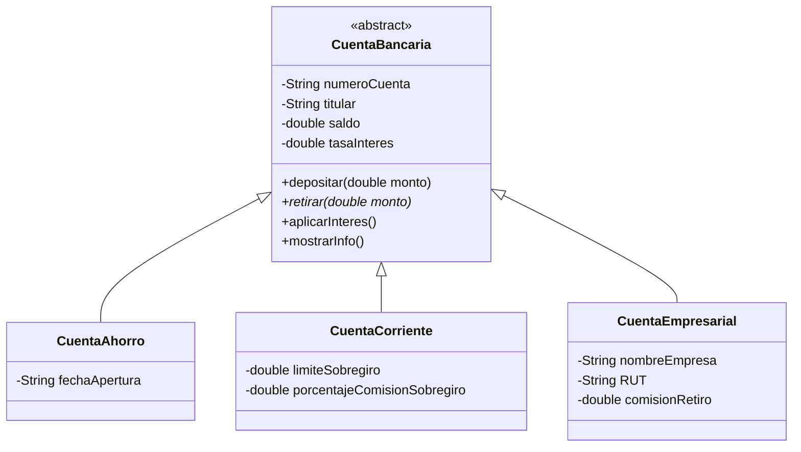

# 🏦 Sistema de Cuentas Bancarias (Java POO)

Laboratorio **TIFC2DEV-JAVA-MJ3 – BankAccount**.
Sistema de consola en Java que gestiona tres tipos de cuentas bancarias aplicando los conceptos de Programación Orientada a Objetos.

---

## 📌 Objetivo

Aplicar los conceptos de POO vistos en clase:

- **Encapsulación** (atributos `private` + getters)
- **Herencia** (`extends`) y uso de `super()`
- **Clases abstractas** y **polimorfismo**
- **Sobreescritura de métodos** (`@Override`)
- Manejo de objetos de forma individual (sin arreglos ni listas)

---

## 🗂️ Estructura del proyecto

```
BankAccount/
├── CuentaBancaria.java     # Clase abstracta (base)
├── CuentaAhorro.java       # Hija de CuentaBancaria
├── CuentaCorriente.java    # Hija de CuentaBancaria
├── CuentaEmpresarial.java  # Hija de CuentaBancaria
├── TestBanco.java          # Clase con el main (escenario de prueba)
└── README.md
```

---

## 🧱 Diagrama de clases



---

## 📋 Reglas de negocio

| Característica | Cuenta de Ahorro | Cuenta Corriente | Cuenta Empresarial |
|---|---|---|---|
| **Saldo mínimo de apertura** | $10,000 | — | $100,000 |
| **Tasa de interés** | 2.5 % anual (fija) | 0.0 % | 1.5 % anual (fija) |
| **Límite de retiro** | Hasta el saldo disponible | Saldo + $50,000 de sobregiro | Saldo disponible (monto + comisión) |
| **Comisión** | Ninguna | 5 % sobre el monto sobregirado | $2,000 por cada retiro |
| **Atributos extra** | `fechaApertura` | `limiteSobregiro`, `porcentajeComisionSobregiro` | `nombreEmpresa`, `RUT`, `comisionRetiro` |

### Clase base `CuentaBancaria` (abstracta)

- **Atributos privados:** `numeroCuenta`, `titular`, `saldo`, `tasaInteres`.
- **Constructor:** valida que el saldo inicial y la tasa de interés no sean negativos.
- **Métodos:**
  - `depositar(double monto)`: valida que el monto sea positivo y muestra el nuevo saldo.
  - `retirar(double monto)`: **abstracto**, cada subclase define su lógica.
  - `aplicarInteres()`: aplica la tasa al saldo y muestra el interés generado.
  - `mostrarInfo()`: muestra la información de la cuenta.
  - Getters para todos los atributos (sin setters).

### `CuentaAhorro`
- Constructor recibe `numeroCuenta`, `titular`, `saldoInicial` y `fechaApertura` (la tasa es fija, no se recibe).
- Si el saldo inicial es menor a $10,000 → lanza excepción o muestra error.
- `retirar` rechaza cualquier monto mayor al saldo disponible.

### `CuentaCorriente`
- **Constructor principal:** `numeroCuenta`, `titular`, `saldoInicial`, `limiteSobregiro`, `porcentajeComisionSobregiro`.
- **Constructor secundario:** `numeroCuenta`, `titular`, `saldoInicial` (usa límite `50000` y comisión `5.0` por defecto).
- `retirar`: valida `monto <= saldo + limiteSobregiro`, resta el monto y, si el saldo queda negativo, cobra la comisión sobre el monto sobregirado.

### `CuentaEmpresarial`
- Constructor recibe `numeroCuenta`, `titular`, `saldoInicial`, `nombreEmpresa` y `RUT`.
- Si el saldo inicial es menor a $100,000 → lanza excepción o muestra error.
- `retirar`: valida `monto + comisionRetiro <= saldo`, resta el monto y luego la comisión ($2,000 por defecto).

---

## 🧪 Escenario de prueba (`TestBanco`)

1. **Crear cuentas** (cada una en una variable independiente):

   | Variable | Tipo | Número | Titular | Saldo inicial | Extra |
   |---|---|---|---|---|---|
   | Cuenta 1 | Ahorro | AH001 | Ana Perez | $50,000 | Apertura 2024-01-15 |
   | Cuenta 2 | Corriente | CC001 | Luis Gomez | $20,000 | Valores por defecto |
   | Cuenta 3 | Empresarial | EM001 | Tech Solutions | $200,000 | Empresa: Tech Solutions, RUT: 123456789-0 |
   | Cuenta 4 | Ahorro | AH002 | Maria Lopez | $15,000 | Apertura 2024-02-01 |

2. **Mostrar la información inicial** con `mostrarInfo()`.
3. **Operaciones:**
   - Ana Perez deposita $10,000.
   - Luis Gomez retira $25,000 → entra en sobregiro y se cobra comisión.
   - Tech Solutions retira $10,000 → se cobra comisión por retiro.
   - Maria Lopez intenta retirar $20,000 → error por saldo insuficiente.
4. **Aplicar intereses** a todas las cuentas y mostrar el interés generado.
5. **Mostrar el estado final** de todas las cuentas.
6. **Generar un resumen:**
   - Total de cuentas (4)
   - Saldo total
   - Promedio de saldo
   - Cuenta con el mayor saldo (número, titular y saldo)

---

## ✅ Resultados esperados (para verificar tu salida)

| Cuenta | Cálculo | Saldo final |
|---|---|---|
| AH001 – Ana Perez | 50,000 + 10,000 = 60,000 → interés 2.5 % (1,500) | **$61,500.00** |
| CC001 – Luis Gomez | 20,000 − 25,000 = −5,000 → comisión 5 % (250) → interés 0 | **$-5,250.00** |
| EM001 – Tech Solutions | 200,000 − 10,000 − 2,000 = 188,000 → interés 1.5 % (2,820) | **$190,820.00** |
| AH002 – Maria Lopez | Retiro rechazado → 15,000 → interés 2.5 % (375) | **$15,375.00** |

- **Total de cuentas:** 4
- **Saldo total:** $262,445.00
- **Promedio de saldo:** $65,611.25
- **Mayor saldo:** EM001 – Tech Solutions – $190,820.00

> Nota: estos valores asumen que el interés se suma al saldo al aplicarlo.

---

## ▶️ Cómo compilar y ejecutar

Desde la carpeta del proyecto:

```bash
javac *.java
java TestBanco
```

Requisitos: **JDK 8 o superior** instalado (`java -version` para comprobarlo).

---

## 📊 Criterios de evaluación

- Encapsulación con campos `private` y getters
- Herencia con `extends`, `super()` y clase abstracta
- Sobreescritura de métodos en las clases hijas
- Validación de reglas de negocio en `retirar` y `depositar`
- Manejo correcto de comisiones, sobregiros y saldos mínimos
- Constructores con validación de parámetros
- Escenario de prueba completo y sin errores
- Calidad del código: nombres descriptivos, estructura clara, comentarios útiles

---

## 📦 Entregables

- [ ] `CuentaBancaria.java`
- [ ] `CuentaAhorro.java`
- [ ] `CuentaCorriente.java`
- [ ] `CuentaEmpresarial.java`
- [ ] `TestBanco.java`
- [ ] Captura de pantalla de la ejecución con la salida completa

---

## 💡 Recomendaciones

- Empieza por `CuentaBancaria` y asegúrate de que compile antes de pasar a las hijas.
- Usa `super(...)` en los constructores de las hijas.
- Prueba cada clase a medida que la crees.
- Formatea los valores monetarios con `String.format("%.2f", valor)`.
- Escribe mensajes de error claros e informativos.

---

## 👩‍💻 Autora

Desarrolladora Full Stack Java en formación.